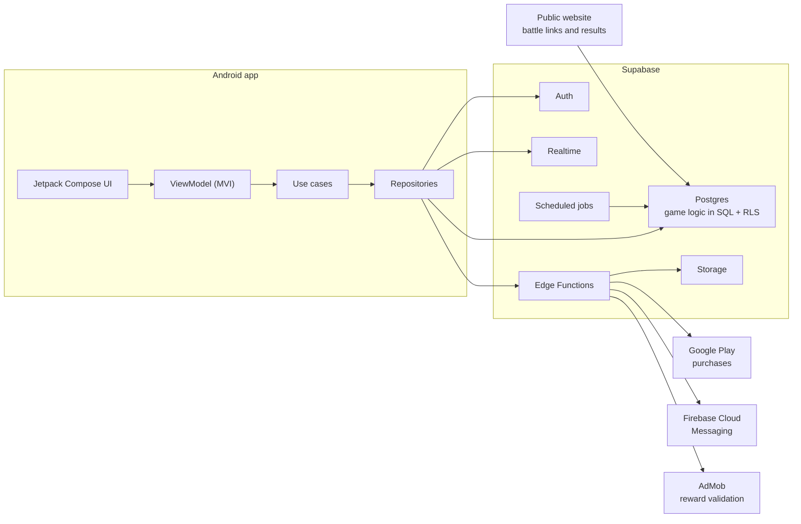

# Aurometro

**The official aura scoreboard.** An Android app for running dance battles, trends and emotes, scoring them with a live jury and following them from the stands with predictions and signs.

> Personal project, built end to end: Android app, backend and public website.
> Currently in closed testing on Google Play. The source code is private; this repository shows what the app does and how it is built.

## What it does

**Battles.** Two sides face off one on one, 2 vs 2 or 4 vs 4, best of five rounds. The organizer sets up the teams, judges, visibility and time per turn, and invites people by their bib number or a shareable link.

**Live jury.** Each judge scores every round from their own phone on technique, aura and creativity. The head judge opens and closes rounds and settles ties, either with a rematch or by letting the audience decide.

**The stands.** The audience joins by link or code, makes a prediction before the battle starts and follows it live in landscape: round scoreboard, turn timer, animated alerts and signs to raise for their side.

**Progression.** Players earn aura by competing, judging and predicting correctly, and spend it to unlock techniques (dances, trends, emotes and poses with video tutorials). Unlocking techniques is what moves you up the ranks.

**Sharing.** Every finished battle produces a result card that can be shared. Links open the public website for anyone who doesn't have the app.

## Architecture

More detail in [docs/architecture.md](docs/architecture.md).

### Key decisions

- **Game logic lives on the server.** Scores, rounds, rewards and the in-app economy are resolved by SQL functions in Postgres. The app only displays the state and calls those functions, so a modified client can't award itself points.
- **Clean Architecture by feature.** Each feature (auth, battle, shop, techniques, profile…) is split into domain, data and presentation. The domain layer has no dependency on Supabase or Android.
- **MVI with unidirectional data flow.** Every screen has a contract with its State, Intents and Effects, and a ViewModel that reduces intents into a new state.
- **One primary action per screen.** Based on Hick's law: each screen has a single main button and the rest are secondary links, to keep decisions quick during a live battle.
- **Real time without depending on the phones.** Battles update live through Supabase Realtime, and a scheduled server job advances the rounds even if nobody has the app open.
- **Purchases and rewards validated server-side.** Google Play purchases and rewarded ads are verified by Edge Functions before anything is granted.

## Tech stack

**Android:** Kotlin, Jetpack Compose (Material 3), Coroutines and Flow, Koin with annotations and KSP, Navigation Compose with type-safe routes, DataStore, Coil, Media3 (ExoPlayer) with local video cache.

**Backend:** Supabase (Auth, Postgres, Row Level Security, Realtime, Storage, Edge Functions in TypeScript), Firebase Cloud Messaging.

**Monetization and privacy:** Google Play Billing, Google Mobile Ads, User Messaging Platform with age-based ad settings.

**Quality and tooling:** JUnit and coroutines-test, Ktlint, Detekt, Compose Rules, Android Lint, Gradle convention plugins, Version Catalog, GitHub Actions CI, Sentry and PostHog (with consent).

## Status

MVP 1.0 complete, in closed testing on Google Play.

## Contact

Álvaro Muñoz Vaquero · [LinkedIn](https://www.linkedin.com/in/alvaroo-munoz-vaquero/) · [GitHub](https://github.com/AlvaroOlivix)
