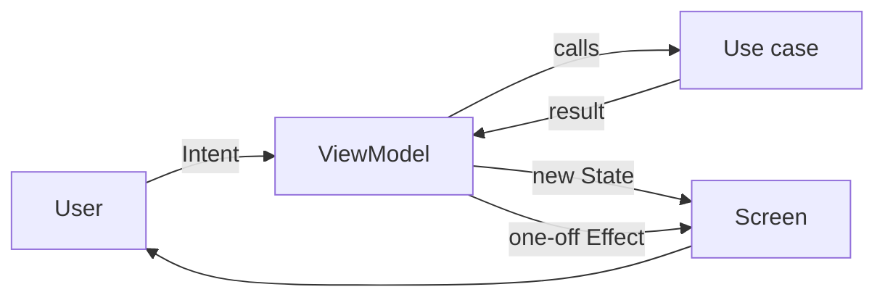
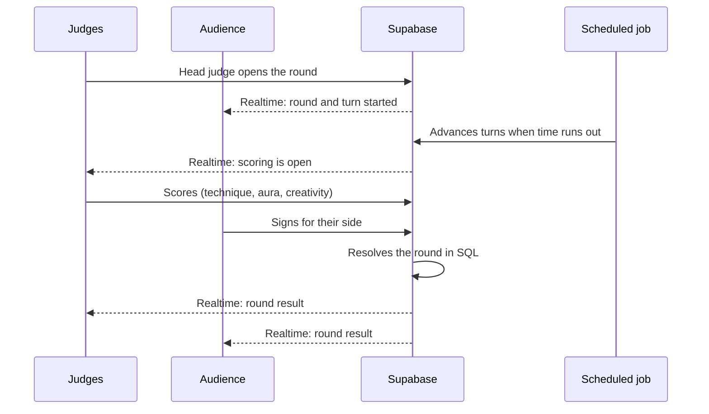

# Architecture

## Layers

Each feature is a self-contained package with three layers:

| Layer | Contains | Depends on |
| --- | --- | --- |
| **Presentation** | Compose screens, Route, ViewModel, Contract (State, Intent, Effect) | Domain |
| **Domain** | Models, repository interfaces, use cases | Nothing |
| **Data** | DTOs, mappers, remote data sources, repository implementations | Domain |

Shared code lives in `core`: design system, networking, ads, billing, analytics, monitoring and push notifications.

```text
app/
  core/        design system, network, ads, billing, analytics, monitoring, push
  feature/     auth, battle, coins, entry, onboarding, privacy, profile, settings, shop, techniques
  navigation/  NavHost and main tabs
build-logic/   Gradle convention plugins
supabase/      database migrations and Edge Functions
web/           public website: battle links, results and legal pages
```

## MVI flow



- **State** is a single immutable object that the screen renders.
- **Intents** are everything the user can do on the screen.
- **Effects** are one-off events such as navigation or a snackbar.

## A live battle



The server is the single source of truth. Phones only send actions and render the state they receive, so every judge and every member of the audience sees the same thing at the same moment.

## Edge Functions

| Function | Purpose |
| --- | --- |
| Purchase verification | Validates Google Play purchases before granting anything |
| Real-time developer notifications | Keeps purchases in sync with refunds and changes from Google Play |
| Ad reward validation | Confirms rewarded ads through AdMob server-side verification |
| Invite notifications | Sends push notifications for battle invites |
| Video links | Gives temporary access to tutorial videos only to players who own the technique |

## Quality

- Unit tests for game rules, screen state, mappers and ViewModels.
- Ktlint, Detekt and Compose Rules for style and static analysis.
- GitHub Actions runs tests, linters, Android Lint and the debug build on every pull request, and the release build on `main`.
- Separate development and production environments, one per build type.
